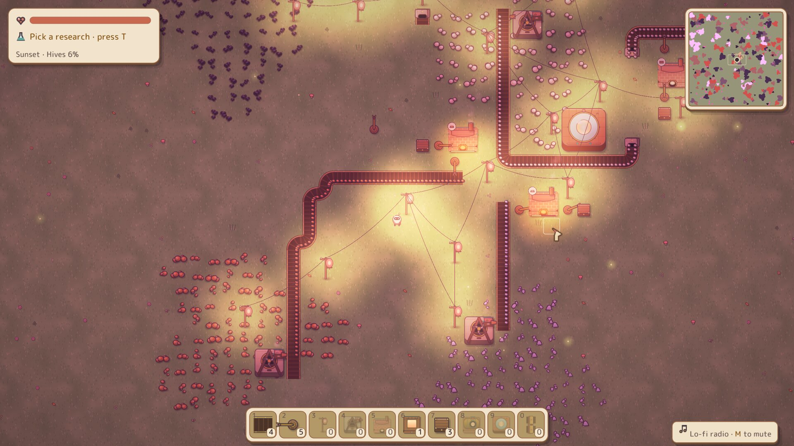

The first playable preview of **Cogworks**, a cozy 2D automation game.

Start with a few tools in a meadow, build up drills, belts, arms, smelters and assemblers, research 15 technologies, keep the hives calm (or turn on peaceful mode with **P**), and wake the Grand Engine to win.

## Download

| Platform | File |
| --- | --- |
| Windows 10/11 (64-bit) | `cogworks-v0.1.0-windows-x86_64.zip` |
| Linux (x86_64) | `cogworks-v0.1.0-linux-x86_64.tar.gz` |
| macOS (Apple Silicon) | `cogworks-v0.1.0-macos-arm64.tar.gz` |
| macOS (Intel) | `cogworks-v0.1.0-macos-x86_64.tar.gz` |

Unpack it and run `cogworks` (or `cogworks.exe`). Everything is built into that one file. Press **H** in the game for controls.

**First launch:** the builds aren't code-signed yet.
- **Windows:** if SmartScreen appears, click *More info* → *Run anyway*.
- **macOS:** right-click the file → *Open*, or run `xattr -d com.apple.quarantine cogworks` in the folder.
- **Linux:** needs an OpenGL driver and ALSA (`libasound2`), which almost every desktop already has.

Saves go to `cogworks_save.json` (F5) and `cogworks_autosave.json` next to wherever you run the game from.

## Known limitations

This is an early preview: expect rough edges in balance, and save files may not carry over to future versions. Bug reports and ideas are welcome in [Issues](https://github.com/dmytrochornyi/cogworks/issues).

## Licence

Cogworks is free to play, modify and share for noncommercial purposes under the [PolyForm Noncommercial 1.0.0](https://polyformproject.org/licenses/noncommercial/1.0.0/) licence. Commercial use needs the author's permission.
