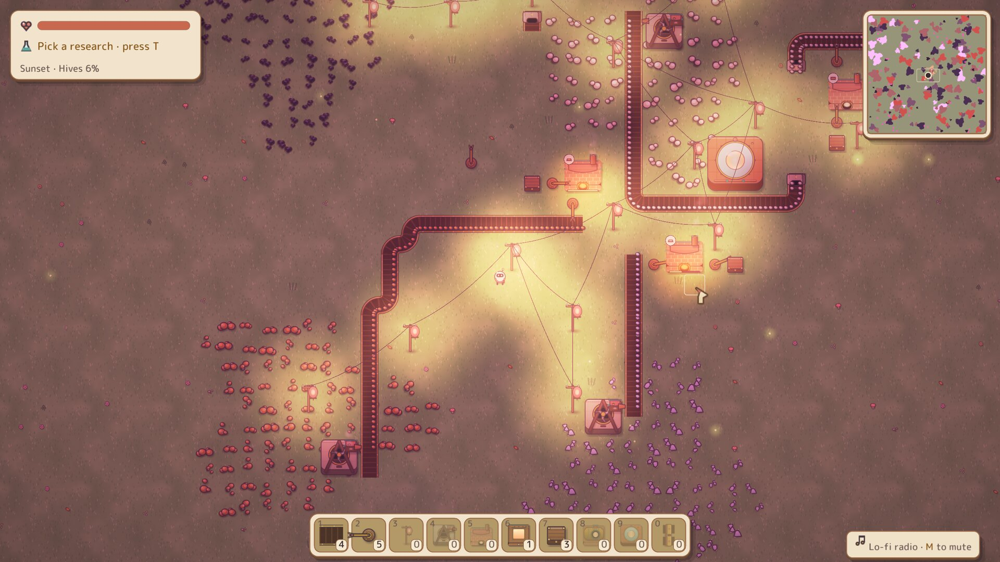
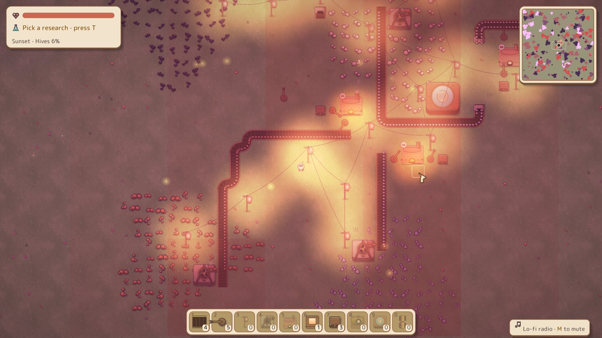

<div align="center">

# ⚙️ Cogworks

**A cozy 2D automation game written in Rust.**

Mine ore by hand, lay belts and robotic arms, smelt and assemble your way up a
research tree, keep the smoke-sensitive hives at bay, and finally wake the
**Grand Engine**.




</div>

## About

Cogworks is a small factory-building game with a warm, hand-painted look and a
lo-fi soundtrack. You start alone in a meadow with a few tools. Ore patches sit
all around, and the hives at the edge of the map don't like smoke.
Build a chain from drills to smelters to assemblers to labs, unlock new
technology one vial at a time, and grow the base until it can power the
Grand Engine.

Sprites are painted procedurally by the project's own asset generator, and
sprites, sounds and the font are all embedded in a single executable.

## Screenshots

| | |
| :---: | :---: |
|  |  |
| *Lamp poles light the base as dusk falls* | *The first morning: ore fields and the welcome note* |
|  |  |
| *Backpack and workbench: missing parts are crafted for you* | *The research tree, from Logistics up to the Grand Engine* |
|  | |
| *Pollution overlay: smoke drifts toward the hives* | |

## Features

- **Logistics**: two-lane conveyors, tunnel belts, splitters, robotic arms and crates
- **Production**: drills, smelters, assemblers and labs, from iron ore to processors and aether cores
- **Research**: a tree of 15 technologies fed by four kinds of data vials
- **Power**: coal generators, solar panels and lamp-topped power poles
- **Fluids**: wellheads, pipes, refineries and mixers for crude tar and naphtha
- **Defence**: pollution wakes the hives; hold them off with walls and sentries, or play in peaceful mode
- **Atmosphere**: a day-to-dusk cycle with real-time lighting, a lo-fi radio, ambience and foley
- **Quality of life**: quickbar binding, building copy (Q), minimap, save/load and autosave

## Download

Grab the latest build for Windows, Linux or macOS from the
[**Releases page**](https://github.com/dmytrochornyi/cogworks/releases),
unpack it and run `cogworks`. Everything is built into that one file.

## Building from source

You need a recent stable Rust toolchain (edition 2024, Rust 1.85 or newer).

```sh
git clone https://github.com/dmytrochornyi/cogworks.git
cd cogworks
cargo run --release
```

On Linux, macroquad needs the usual windowing and audio headers. On Debian or Ubuntu:

```sh
sudo apt install pkg-config libx11-dev libxi-dev libgl1-mesa-dev libasound2-dev
```

The game saves to `cogworks_save.json` (F5) and `cogworks_autosave.json`
in the directory you run it from. F9 loads the newest of the two.

## Controls

| Key | Action |
| --- | --- |
| <kbd>W</kbd><kbd>A</kbd><kbd>S</kbd><kbd>D</kbd> / arrows | Walk |
| Mouse wheel | Zoom |
| Left click | Build (drag for belts, pipes and walls) or open a building |
| Right hold | Mine ore by hand, or pick a building back up |
| <kbd>1</kbd>–<kbd>0</kbd> | Quickbar (hover an inventory item and press a number to bind it) |
| <kbd>R</kbd> / <kbd>Shift</kbd>+<kbd>R</kbd> | Rotate clockwise / counter-clockwise |
| <kbd>Q</kbd> | Copy the hovered building, or empty your hands |
| <kbd>E</kbd> / <kbd>Tab</kbd> | Backpack and workbench |
| <kbd>T</kbd> | Research |
| <kbd>Esc</kbd> | Close the panel, or put the tool away |
| <kbd>Space</kbd> | Pause |
| <kbd>O</kbd> | Pollution overlay |
| <kbd>P</kbd> | Peaceful mode |
| <kbd>M</kbd> | Toggle music |
| <kbd>F5</kbd> / <kbd>F9</kbd> | Save / load |
| <kbd>H</kbd> / <kbd>F1</kbd> | Help note |

### Tips

- Arms carry items from the tile behind them to the tile in front.
- Drills drop ore at their chute, so point the chute at a belt or a crate.
- Belts have two lanes. Feeding a belt from the side fills the lane nearest to you.
- Machines need power: burn coal in a Generator and spread the power with poles.

## Development

```sh
cargo test                              # unit tests
cargo run --release --bin gen_assets    # repaint every sprite into assets/
```

| Path | What lives there |
| --- | --- |
| `src/world/` | Simulation: entities, logistics, production, power, fluids, combat, world generation |
| `src/render/` | Camera, ground, entities, lighting, sky and particles |
| `src/ui/` | HUD, panels, tooltips, minimap and shared widgets |
| `src/bin/gen_assets/` | Procedural sprite painter that writes `assets/sprites/` |
| `tools/music/` | Offline build tool for the music, ambience and sound effects ([README](tools/music/README.md)) |

## Assets and licences

- **Code and sprites**: MIT. See [`LICENSE`](LICENSE).
- **Font**: [M PLUS Rounded 1c](https://fonts.google.com/specimen/M+PLUS+Rounded+1c),
  SIL Open Font License 1.1. See [`assets/fonts/OFL.txt`](assets/fonts/OFL.txt).
- **Music, ambience and sound effects** (`assets/audio/`): original arrangements
  and edits built from the free sample packs by [Mondo Loops](https://mondoloops.com)
  (*Dreamy Lofi Hip Hop Samples Vol. 1* and *Organic Lofi Hip Hop Vol. 1*).
  These files are **not** covered by the MIT licence. Don't extract them for
  reuse as samples or register them with Content ID. The raw packs aren't
  included in this repository.
