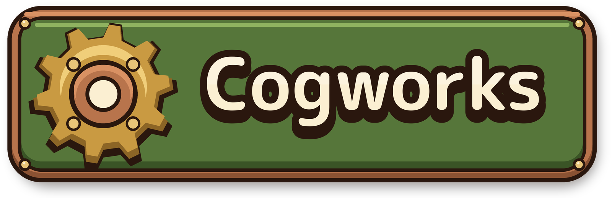
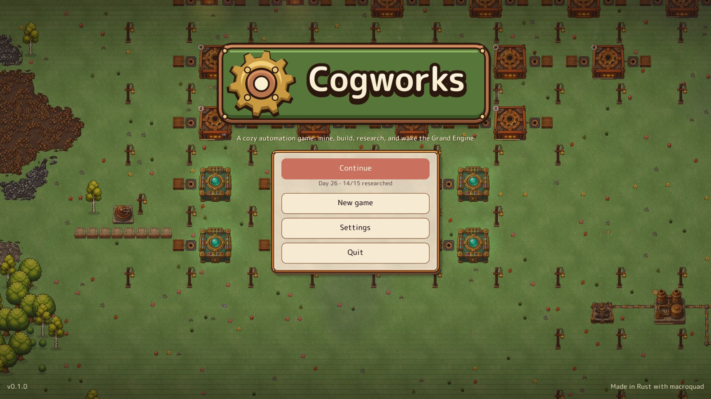
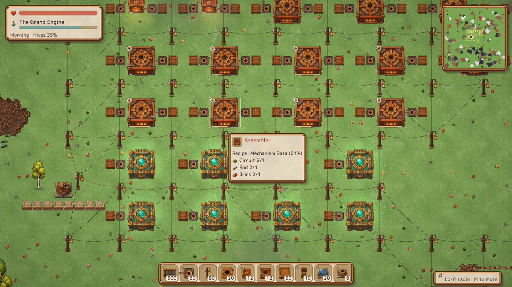
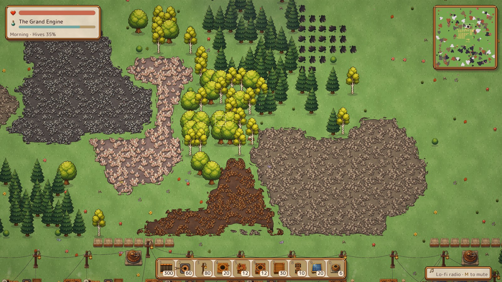
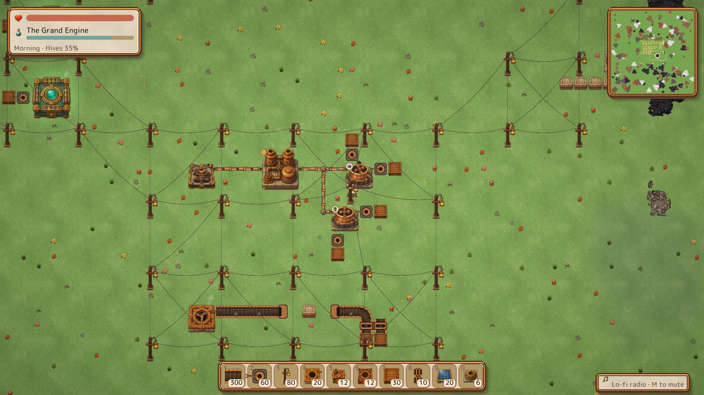
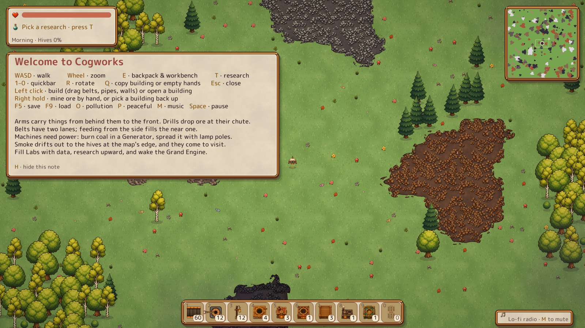
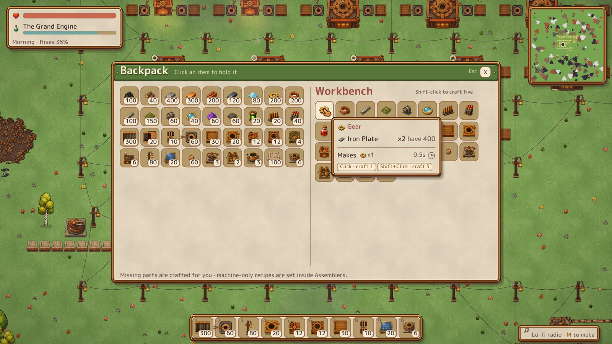
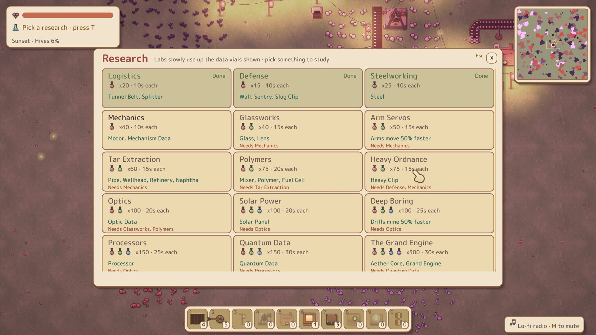
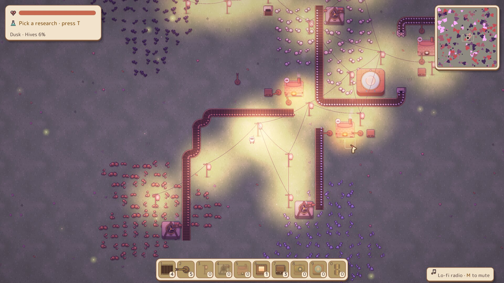

<div align="center">



**A cozy 2D automation game written in Rust.**

Mine ore by hand, lay belts and robotic arms, smelt and assemble your way up a
research tree, keep the smoke-sensitive hives at bay, and finally wake the
**Grand Engine**.




</div>

## About

Cogworks is a small factory-building game with a warm, hand-painted look and a
lo-fi soundtrack. You start alone in a meadow with a few tools. Ore patches sit
all around, and the hives at the edge of the map don't like smoke.
Build a chain from drills to smelters to assemblers to labs, unlock new
technology one vial at a time, and grow the base until it can power the
Grand Engine.

The art is a mix of painted sprites (kept in `assets/art/`) and pieces
painted by the project's own tools: seamless ore fields, copper pipes, the
robot's turned views and the logo. Sprites, sounds and the font are all
embedded in a single executable.

## Screenshots

| | |
| :---: | :---: |
|  |  |
| *A late-game base: assembly lines feeding the labs* | *Ore deposits, each one continuous field, beside the woods* |
|  |  |
| *Tar to naphtha: wellhead, refinery and mixers on copper pipes* | *The first morning: a few tools and the welcome note* |
|  |  |
| *Backpack and workbench: missing parts are crafted for you* | *The research tree, from Logistics up to the Grand Engine* |
|  | |
| *Lamp poles light the base as dusk falls* | |

## Features

- **Logistics**: two-lane conveyors, tunnel belts, splitters, robotic arms and crates
- **Production**: drills, smelters, assemblers and labs, from iron ore to processors and aether cores
- **Research**: a tree of 15 technologies fed by four kinds of data vials
- **Power**: coal generators, solar panels and lamp-topped power poles
- **Fluids**: wellheads, pipes, refineries and mixers for crude tar and naphtha
- **Defence**: pollution wakes the hives; hold them off with walls and sentries, or play in peaceful mode
- **Atmosphere**: a day-to-dusk cycle with real-time lighting, a lo-fi radio, foley, and gentle environmental ambience (soft bells, mallets, pads and water by day; crickets at night)
- **Menus**: a title screen with Continue and New game (normal or peaceful), a pause menu, and settings for music, ambience, effects and fullscreen
- **A hovering robot**: glides smoothly and turns to face all eight directions as it moves
- **Quality of life**: quickbar binding, building copy (Q), icon tooltips, minimap, save/load and autosave

## Download

Grab the latest build for Windows, Linux or macOS from the
[**Releases page**](https://github.com/dmytrochornyi/cogworks/releases),
unpack it and run `cogworks`. Everything is built into that one file.

## Building from source

You need a recent stable Rust toolchain (edition 2024, Rust 1.85 or newer).

```sh
git clone https://github.com/dmytrochornyi/cogworks.git
cd cogworks
cargo run --release
```

On Linux, macroquad needs the usual windowing and audio headers. On Debian or Ubuntu:

```sh
sudo apt install pkg-config libx11-dev libxi-dev libgl1-mesa-dev libasound2-dev
```

The game saves to `cogworks_save.json` (F5) and `cogworks_autosave.json`
in the directory you run it from. The title screen continues the newest of
the two, and F9 loads it during play. Settings are kept in
`cogworks_settings.json`. To skip the title screen, run `cogworks <save file>`.

## Controls

| Key | Action |
| --- | --- |
| <kbd>W</kbd><kbd>A</kbd><kbd>S</kbd><kbd>D</kbd> / arrows | Walk |
| Mouse wheel | Zoom |
| Left click | Build (drag for belts, pipes and walls) or open a building |
| Right hold | Mine ore by hand, or pick a building back up |
| <kbd>1</kbd>–<kbd>0</kbd> | Quickbar (hover an inventory item and press a number to bind it) |
| <kbd>R</kbd> / <kbd>Shift</kbd>+<kbd>R</kbd> | Rotate clockwise / counter-clockwise |
| <kbd>Q</kbd> | Copy the hovered building, or empty your hands |
| <kbd>E</kbd> / <kbd>Tab</kbd> | Backpack and workbench |
| <kbd>T</kbd> | Research |
| <kbd>Esc</kbd> | Close the panel, put the tool away, or open the pause menu |
| <kbd>Space</kbd> | Pause |
| <kbd>O</kbd> | Pollution overlay |
| <kbd>P</kbd> | Peaceful mode |
| <kbd>M</kbd> | Toggle music |
| <kbd>F5</kbd> / <kbd>F9</kbd> | Save / load |
| <kbd>H</kbd> / <kbd>F1</kbd> | Help note |

### Tips

- Arms carry items from the tile behind them to the tile in front.
- Drills drop ore at their chute, so point the chute at a belt or a crate.
- Belts have two lanes. Feeding a belt from the side fills the lane nearest to you.
- Machines need power: burn coal in a Generator and spread the power with poles.

## Development

```sh
cargo test                              # unit tests
cargo run --release --bin gen_assets    # repaint every sprite into assets/
python3 tools/art/fields.py             # ore-field textures and pipe pieces
python3 tools/art/diagonals.py          # the robot's 3/4 views
python3 tools/art/logo.py               # logo and window icon
```

The art scripts write into `assets/art/`; run `gen_assets` afterwards to pick
them up. `COGWORKS_SCREENSHOT=out.png` renders a few seconds, saves a
screenshot and quits. `COGWORKS_SCREEN` (`title`, `newgame`, `settings`,
`pause`), `COGWORKS_PANEL`, `COGWORKS_DAY_PHASE` and `COGWORKS_FULLSCREEN=1`
set up what the screenshot shows.

| Path | What lives there |
| --- | --- |
| `src/world/` | Simulation: entities, logistics, production, power, fluids, combat, world generation |
| `src/render/` | Camera, ground, entities, lighting, sky and particles |
| `src/ui/` | HUD, panels, menus, tooltips, minimap and shared widgets |
| `src/bin/gen_assets/` | Procedural sprite painter that writes `assets/sprites/` |
| `tools/art/` | Scripts that prepare painted art and paint the ore fields, pipes, robot views and logo |
| `tools/music/` | Offline build tool for the music, ambience and sound effects ([README](tools/music/README.md)) |

## Assets and licences

- **Code and sprites**: [PolyForm Noncommercial 1.0.0](https://polyformproject.org/licenses/noncommercial/1.0.0/).
  See [`LICENSE`](LICENSE). You're free to play, study, modify and share
  Cogworks for any noncommercial purpose. Selling it, or using it in a
  commercial product, is not allowed without the author's permission.
- **Font**: [M PLUS Rounded 1c](https://fonts.google.com/specimen/M+PLUS+Rounded+1c),
  SIL Open Font License 1.1. See [`assets/fonts/OFL.txt`](assets/fonts/OFL.txt).
- **Music and sound effects** (`assets/audio/music/`, `assets/audio/sfx/`): original
  arrangements and edits built from the free sample packs by [Mondo Loops](https://mondoloops.com)
  (*Dreamy Lofi Hip Hop Samples Vol. 1* and *Organic Lofi Hip Hop Vol. 1*).
  These files are **not** covered by the PolyForm licence. Don't extract them for
  reuse as samples or register them with Content ID. The raw packs aren't
  included in this repository.
- **Ambience** (`assets/audio/ambience/`): synthesised from scratch by
  `tools/music/environmental.py`, with no samples, and covered by the PolyForm licence like the code.
